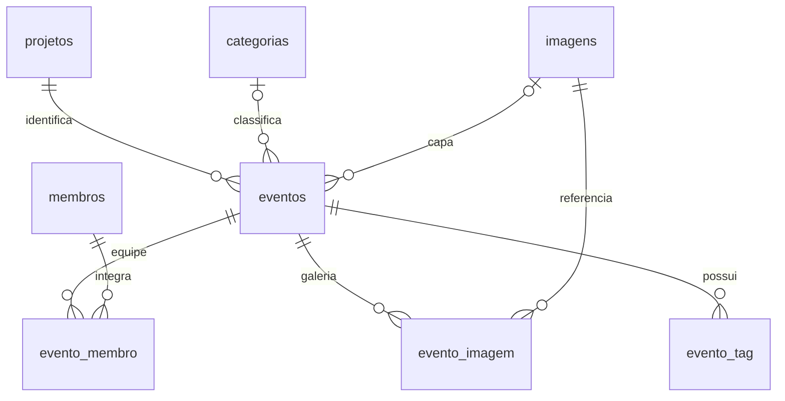

# CDI/LabSoci — migração PostgreSQL (pacote de integração)

Base: ZIP `Site_ClubedoImprovisoeLabsoci-main`, snapshot de 20/11/2026. Este pacote é um **overlay**: contém somente arquivos novos ou substitutos da camada de dados, não o frontend nem o banco pessoal. Não copie por cima de alterações de outros integrantes sem comparar. Use branch própria e banco local descartável. PostgreSQL 17 foi escolhido como alvo conservador. O SQL e a integração foram preparados, mas a execução em PostgreSQL real depende da validação local.

## Modelo e regras adotadas



- Oito tabelas, uma view `eventos_api` para manter o formato de resposta React. `proj` e `categoria` são códigos de domínio, não IDs artificiais. `categoria` é opcional. Códigos da UI: `apresentacao`, `oficina`, `terca`, `Ensaio`; projetos `cdi`, `lab`, `-`.
- Datas DATE e horas TIME(0); datas serializadas pela view no formato YYYY-MM-DD. Booleanos PostgreSQL são compatíveis com os tipos do frontend. Entrada TEXT porque a UI admite texto livre, e matrícula TEXT porque é identificador. Não foi adicionada classificação indicativa, ausente do schema atual.
- A capa é opcional e referencia `imagens.id`; URL única permite compartilhar imagem entre capa e galeria. `membros.foto_url` continua armazenando a referência existente, inclusive nomes de arquivo; não se migram imagens binárias. `evento_tag` permite várias tags por evento. Excluir eventos remove seus vínculos; excluir membros/imagens ainda vinculados é proibido; desativar membro preserva o histórico. Não se elimina automaticamente arquivo físico ou imagem sem vínculos: definir política de uploads com a equipe.
- Preserva as APIs atuais e a autenticação por cookie. Não implementa CRUD de membros nem upload de arquivos, atividades compartilhadas com o integrante responsável por esses endpoints. A matrícula não é retornada nas APIs públicas. O usuário local do Docker é proprietário/superusuário do cluster: antes de produção, criar papel de aplicação separado com privilégios mínimos, configurar TLS e backups. Não usar as senhas de exemplo em produção.

## 1. Preparação (PowerShell, na raiz do projeto)

1. Pare o servidor original e guarde uma cópia privada do `database.db` fora do repositório. Mantenha o ZIP original intacto.
2. Crie uma branch, se estiver usando Git: `git switch -c feature/postgresql`.
3. Extraia o conteúdo deste pacote na raiz do projeto original; compare `server.cjs` e `.gitignore` com alterações mais recentes da equipe. Não substitua `src/`, `public/` ou o SQLite. O backend deste pacote corresponde exatamente ao snapshot analisado, não a commits novos.
4. Copie `.env.example` para `.env` se ainda não existir. Se já existir, acrescente os campos `PG*` sem perder credenciais administrativas existentes. Preencha as senhas localmente. Gere `SESSION_SECRET` com `node -e "console.log(require('crypto').randomBytes(32).toString('hex'))"`.

## 2. PostgreSQL local (Docker Desktop ou Docker Engine/WSL2)

Na raiz do projeto, com Docker Compose disponível, execute:

```powershell
docker compose up -d postgres
docker compose ps
docker compose exec -T postgres pg_isready -U cdi_app -d cdi
```

A porta no host é 5433; a interna é 5432. Se alterar PGUSER ou PGDATABASE, adapte os comandos abaixo. Não reutilize um volume existente de outro projeto. Não execute `docker compose down -v` se houver dados que queira preservar.

```powershell
docker compose cp database/migrations/001_schema.sql postgres:/tmp/001_schema.sql
docker compose exec -T postgres psql -U cdi_app -d cdi -v ON_ERROR_STOP=1 -f /tmp/001_schema.sql
```

A migração de esquema é transacional e deve ser executada **uma vez** em banco vazio. Se falhar, envie o erro; não apague volumes nem tente forçar a criação. Confirme:

```powershell
docker compose exec -T postgres psql -U cdi_app -d cdi -c "\dt"
```

Esperado: oito tabelas. A view `eventos_api` aparece em `\dv`.

## 3. Preparar migração do SQLite (não altera o original)

Com Python 3.10+ instalado, execute:

```powershell
py -3 database/scripts/migrate_sqlite.py database.db
```

Caso `py` não esteja disponível, use `python` ou `python3`. O script abre o SQLite somente para leitura, verifica integridade e FK, confere SHA-256 antes/depois e gera `database/private/import.sql`, `quarentena.json` e `relatorio.json`. **Não compartilhe import.sql nem o SQLite**, pois contêm matrículas. O relatório de contagens não contém valores de matrículas.

Resultado constatado ao executar o script contra o ZIP: 60 eventos, 14 membros, 9 vínculos evento-membro; 54 eventos teste excluídos do lote, evento 58 Ensaio Aberto em quarentena por data inválida (`0`), 5 eventos aptos, todos os 9 vínculos aptos, 14 matrículas. O horário 06:02 de Oficina de música permanece inalterado até autorização. As sequências são ajustadas para preservar IDs e evitar reutilizar o ID 58 reservado.

Se a equipe confirmar a data do evento 58 **antes da importação**, regenere com `--data-ensaio AAAA-MM-DD` substituindo pela data real. Não use data inventada. Após importar, não execute novamente o lote sobre banco povoado; recuperar evento 58 exigirá inserção específica revisada.

Confira o relatório antes de executar o lote:

```powershell
Get-Content database/private/relatorio.json
```

## 4. Importar e auditar

```powershell
docker compose cp database/private/import.sql postgres:/tmp/cdi-import.sql
docker compose exec -T postgres psql -U cdi_app -d cdi -v ON_ERROR_STOP=1 -f /tmp/cdi-import.sql
docker compose exec -T postgres rm -f /tmp/cdi-import.sql
docker compose cp database/scripts/validate.sql postgres:/tmp/cdi-validate.sql
docker compose exec -T postgres psql -U cdi_app -d cdi -v ON_ERROR_STOP=1 -f /tmp/cdi-validate.sql
```

O lote verifica destino vazio, contagens e diferenças de conteúdo bidirecionais antes do COMMIT. Esperado (sem data corrigida): eventos 5, membros 14, evento_membro 9, imagens 0, evento_imagem 0, evento_tag 0, projetos 3, categorias 4, matrículas 14, órfãos 0, eventos teste 0. Com data corrigida, eventos 6; demais quantidades iguais para o snapshot. A validação usa somente metadados, contagens e dados públicos de eventos, sem listar matrículas.

## 5. Integração Node.js

O overlay contém `server.cjs` e `db.cjs` migrados. Execute na raiz do projeto, depois de copiar os arquivos e configurar o .env:

```powershell
npm install pg
npm pkg set scripts.start="node server.cjs"
npm run build
npm start
```

`npm install pg` atualiza package.json e package-lock.json para versionamento reprodutível. Não foi gerado lockfile fictício neste pacote. Quando não houver outro código dependente de sqlite3, remova a dependência com `npm uninstall sqlite3` (não apaga o arquivo de banco). O servidor exige schema pronto e mantém os contratos de login, logout, sessão e eventos/membros/galeria/tags. A porta é 3000. Para desenvolvimento do React, opcionalmente `npm run dev` em outro terminal (proxy /api já existente).

## 6. Testar (outro terminal; ambiente local apenas)

```powershell
node database/scripts/test_api.cjs
```

Teste automático da API: autorização, login, CRUD, formato data/hora, duas tags, relacionamento de membro, capa e galeria compartilhando imagem, ausência de matrícula nas APIs públicas, rollback de edição inválida, rejeição de datas e membros inexistentes, exclusão em cascata, logout. Cria registros temporários com marcador único e tenta limpá-los ao final; sequências podem avançar. Execute apenas em desenvolvimento, não em produção. Se algum teste falhar, compartilhe a mensagem e não considere a etapa aprovada.

Depois, valide no navegador: Início, Eventos, Sobre, detalhe, login admin, cadastrar evento, editar capa, incluir duas tags, selecionar membro, excluir evento temporário. Não use dados reais como teste de escrita.

## 7. Git, backup e pendências

O novo `.gitignore` ignora SQLite, dados gerados em `database/private`, .env e backups. Ignorar não retira arquivos já rastreados: depois de fazer backup, `git rm --cached -- database.db` retira o banco do próximo commit sem apagá-lo do disco. Confirme com `git status --short`. Se o histórico já contém dados pessoais, tratar com os responsáveis pelo repositório, sem reescrever histórico unilateralmente.

Antes de produção, definir hospedagem, papel de aplicação de mínimo privilégio, TLS e política de backup/restauração, armazenamento persistente das imagens, CRUD de membros/upload com colegas, categorias adicionais e data real do evento 58. Guardar a matrícula internamente é autorização de migração, não de divulgação pública. O sistema atual autentica com variáveis de ambiente.

## 8. Evidência de verificação feita antes da entrega

- Inspeção do ZIP, SQLite em leitura e código atual.
- Script Python executado com a base original; integridade ok, sem órfãos; hash da origem preservado; contagens confirmadas; SQL de migração preparado.
- `node --check` nos três arquivos .cjs.
- O ambiente de preparação não tem servidor PostgreSQL, Docker ou dependências npm do projeto disponíveis. Portanto execução SQL, instalação de pg, build React, testes de API e deploy ainda não foram comprovados. Estes são os próximos gates locais, e não resultados já aprovados.
